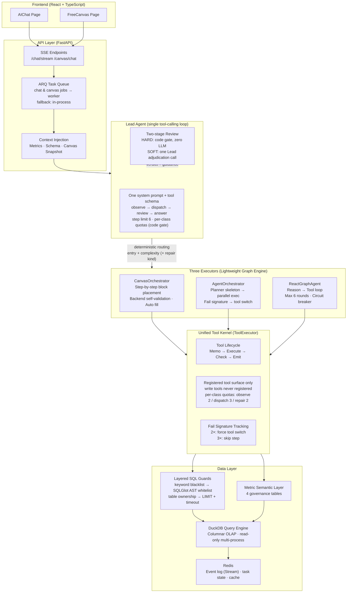

# LvcoBI — AI-Powered Data Analysis Platform (Text-to-BI)

**Turn natural language into insightful data visualizations.**

LvcoBI is a full-stack BI SaaS platform that lets users interact with their data through natural language. It features a single-agent LLM orchestration loop with a tool layer, a metric semantic layer, and a canvas-based drag-and-drop visualization workspace.

[](https://www.python.org/)
[](https://fastapi.tiangolo.com/)
[](https://react.dev/)
[](https://duckdb.org/)
[](LICENSE)

---

## Architecture Overview



### Key Design Points

| Point | What | Why |
|-------|------|-----|
| **A** | Single-agent tool loop (`LEAD_AGENT_MODE=single_agent`) | One system prompt instead of four prompt workstations; tool calls are the decision points, each carrying a model-stated `reason` |
| **B** | Executor tool whitelist narrowed to placement-only | Prevents "query but don't chart" |
| **C** | fail_signature tracking | Same signature 2× fail → force switch; 3× → skip |
| **D** | Layered SQL guards | AST full-check is fail-closed (parse failure → reject); table-ownership sub-check degrades to allow with read-only DuckDB as the backstop |

### Key Tradeoffs

- **Custom lightweight graph engine vs LangGraph.** The executor kernels need precise, testable control over convergence gates and review instrumentation. A hand-rolled graph keeps those gates as plain code (step limits, per-class quotas, forced terminal actions) with unit tests, instead of relying on framework abstractions.
- **Redis Stream for the event log, not Pub/Sub or Lists.** Events must be replayable: a refresh or reconnect reads from its own cursor. Pub/Sub does not persist (offline readers lose everything); Lists are consumed destructively (multiple readers steal from each other). A Stream is append-only, per-reader cursor addressed, and capped (MAXLEN).
- **Review is a fixed pipeline stage, not a tool.** If reviewing were a callable tool, the model could choose not to call it, and the acceptance verdict would lose its guarantee. HARD facts (execution failure, zero blocks, tool-chain failures) are settled by code with zero LLM cost; only soft questions get one structured adjudication call.
- **Context budgets are declared in tokens; characters are only a derived compatibility unit.** Different block kinds have different char-to-token ratios (Chinese prose ≈ 1.0, mixed text 0.6, JSON 0.4). A single token-based budget lets every source share one accounting ledger.

---

## Project Flow (Canvas Conversation Example)

```
User: "Analyze sales by category, brand, and season"
   │
   ▼
① Frontend (AIChat/FreeCanvas)
   │ POST /api/v1/ai/canvas/chat (SSE stream)
   │ Zustand store: stream survives route switches
   ▼
② API Layer
   │ Inject: canvas snapshot + governed metrics list
   │ Session: 1:1 binding per canvas
   │ TASK_QUEUE_ENABLED → ARQ job (worker process); fallback: in-process task
   ▼
③ Lead Agent (single tool-calling loop)
   │ intent (request-level label) → decision (per-step, model-stated reason)
   │ observe tools (≤2): canvas layout / datasources / fields / metrics / 5-row sample
   │ dispatch_analysis → deterministic routing: entry=canvas → CanvasOrchestrator
   ▼
④ CanvasOrchestrator
   │ plan → execute_steps → finish
   │ Planner generates skeleton (3 chart steps + narrative)
   │ Mini-ReAct loop: LLM → ToolExecutor → goal validation
   │ Auto chart filling (if <2 chart types, auto-fill one)
   │ Auto layout arrange (deterministic, not LLM-triggered)
   ▼
⑤ ToolExecutor
   │ Memo (idempotency) → execute → error check → emit
   │ add_chart_block: back-end self-validation via execute_chart_query
   ▼
⑥ Two-stage Review & Memory
   │ Stage 1 (code, zero LLM): HARD gate — execution failed / zero blocks / tool-chain failures
   │ Stage 2 (only if SOFT items exist): one Lead adjudication → verdict/reason/guidance
   │ Fail → repair (lightweight patch) or re-dispatch; repair bypasses the memo cache
   │ _maybe_summarize: water-mark driven memory merge → ai_memories upsert
   ▼
   SSE: intent → decision → progress → tool_call → canvas_action → done
   Events persist to a Redis Stream (MAXLEN 2000): refresh/reconnect replays from a cursor
   Frontend renders canvas blocks in real-time
```

---

## Multi-Agent Orchestration

| Component | Role | Mechanism |
|-----------|------|-----------|
| **Lead Agent** | Single tool-calling loop (default; legacy supervisor mode still available via `LEAD_AGENT_MODE`) | One system prompt + tool schema; observe/dispatch/repair/answer tools; code-level convergence gate (max 6 steps, per-class quotas, forced terminal action) |
| **Canvas Executor** | Step-by-step canvas charting | Tool whitelist narrowed to placement-only; self-validating add_chart_block |
| **General Executor** | Multi-step complex analysis | Planner skeleton → topological parallel execution → fail-signature tracking |
| **React Executor** | Lightweight Q&A | Reason→Tool loop; max 6 rounds; 5-consecutive-fail circuit breaker |

### Three Query Paths

| Path | Tool | When | Security |
|------|------|------|----------|
| **Governed Metric** | `metric_key` | Business metrics with defined caliber | Formula AST whitelist; auto-upgrade to governed caliber |
| **Structured Query** | `query_engine` | Flexible aggregation/grouping/filtering | Parameterized SQL, injection-proof |
| **Raw SQL** | `query_sql` | Complex analytics (window functions, CTEs) | Keyword blacklist → SQLGlot AST whitelist (fail-closed) → table ownership (degrades to allow on parse failure; read-only DuckDB backstop) → LIMIT injection + query timeout |

### Evaluation Results

| Suite | Tests | Result |
|-------|-------|--------|
| Agent Semantic Eval (v2 rubric) | 20 dual-source canvas questions (7 batches) | **94.1%** weighted semantic achievement (80/85); 15/20 full pass |
| Backend test suite | pytest | 1058 passed |
| Frontend test suite | vitest | 54 passed |

> Rubric: v2 structured semantic expectations — each item scores if the expected semantics ⊆ the actual query semantics (metric caliber, dimensions/granularity, filters, sort/limit/blocks, chart types, answer points). Unspecified items are not scored. See `backend/tests/agent_evals/` for per-batch reports.

---

## Reliability

- **Task/connection decoupling.** Both chat and canvas entries run as background tasks (ARQ worker when `TASK_QUEUE_ENABLED=true`, in-process fallback otherwise). The HTTP connection downgrades to a subscriber: refresh or disconnect never kills the task, and reconnects replay from a per-reader cursor in the Redis event log.
- **Idle watchdogs.** Every task stream has an idle timeout that force-closes with a visible error if the agent parks without emitting events.
- **Graceful degradation.** Redis unavailable → in-memory fallbacks and process-local task execution. Report generation falls back to a deterministic template report (zero LLM) when the LLM fails or returns empty.
- **Controlled DuckDB writes.** The database file opens read-only in every process (multi-reader concurrency); imports/deletes go through a Redis-coordinated write window that briefly drains readers.

## Demo

<!-- TODO: 录屏/GIF/在线地址 -->

---

## Tech Stack

| Layer | Technology |
|-------|-----------|
| **Backend** | Python 3.12 • FastAPI • SQLAlchemy • Alembic • PostgreSQL |
| **Query Engine** | DuckDB (columnar OLAP, embedded, read-only shared) |
| **Task Queue** | ARQ (Redis-backed) • Redis Streams (event log) |
| **Frontend** | React 18 • TypeScript • Vite • ECharts 5 • Zustand |
| **AI/Agent** | OpenAI-compatible LLM • Langfuse (observability) • Custom graph engine |
| **Security** | SQLGlot AST-level whitelist • Parameterized queries • RBAC |
| **Deployment** | Docker • Docker Compose • Nginx |

---

## Quick Start

```bash
# Prerequisites: Python 3.12+, Node.js 18+, PostgreSQL 15+, Redis 7+

# Backend
cd backend
cp .env.example .env    # configure DB connection, LLM API key
uv venv
source .venv/bin/activate  # or .venv\Scripts\activate on Windows
uv pip install -r requirements.txt
alembic upgrade head
uvicorn app.main:app --reload

# Task worker (separate terminal; runs chat & canvas background jobs)
.venv/Scripts/python -m arq app.worker.WorkerSettings

# Frontend (separate terminal)
cd frontend
npm install
npm run dev

# Or Docker (full stack)
docker compose up -d
```

---

## Testing

```bash
cd backend
pytest                          # unit + integration
python -m tests.agent_evals.semantic_run_eval  # agent semantic evaluation
```

---

## Project Structure

```
lvco-bi/
├── backend/
│   ├── app/
│   │   ├── api/              # REST endpoints (16 modules)
│   │   ├── core/             # Database, security, DuckDB client, cache
│   │   ├── models/           # SQLAlchemy models (22)
│   │   ├── repositories/     # Data access (UoW pattern)
│   │   ├── services/
│   │   │   ├── agents/       # Orchestration engine
│   │   │   │   ├── lead/     # Lead agent: unified loop, tools, review, dispatch (15 modules)
│   │   │   │   ├── context/  # TurnContextProvider: sources / assembler / budgets / compressor
│   │   │   │   ├── canvas_orchestrator.py
│   │   │   │   ├── agent_orchestrator.py
│   │   │   │   ├── react_agent.py
│   │   │   │   ├── planner_agent.py
│   │   │   │   └── tool_executor.py
│   │   │   ├── canvas_task.py        # Canvas background task kernel (API + worker)
│   │   │   ├── chat_task.py          # Chat background task kernel (API + worker)
│   │   │   ├── event_stream.py       # Redis Stream event log (replayable)
│   │   │   ├── chat_stream_registry.py
│   │   │   ├── canvas_block_writer.py
│   │   │   ├── metric_service.py     # Metric semantic layer
│   │   │   ├── query_engine.py       # Structured query engine
│   │   │   ├── sql_guard_ast.py      # SQLGlot AST SQL protection
│   │   │   ├── session_lock.py       # Session-level concurrency locks
│   │   │   ├── observability.py      # Langfuse integration
│   │   │   └── ...
│   │   └── config.py
│   ├── prompts/              # 22 LLM system prompts (YAML)
│   ├── mock_data/            # 6 sample datasets
│   └── tests/                # 77 test files
├── frontend/
│   └── src/
│       ├── pages/            # 17 page modules
│       ├── components/       # UI components + charts
│       └── stores/           # Zustand state management
└── docker-compose.yml
```

---

## License

MIT
