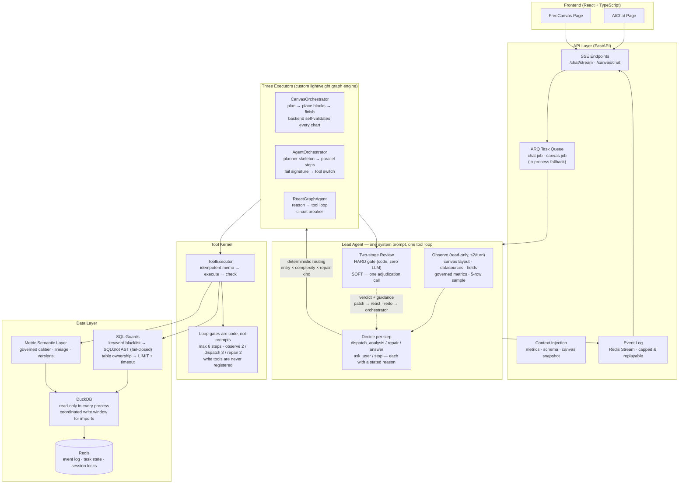

# LvcoBI — AI-Powered Data Analysis Platform (Text-to-BI)

**Turn natural language into insightful data visualizations.**

LvcoBI is a full-stack BI SaaS platform where a **single LLM agent** — the Lead — handles a conversation end to end: it observes your data and canvas through read-only tools, dispatches analysis to specialized executors, judges the result against a code-enforced review gate, and answers with real numbers. A metric semantic layer governs business calibers; a canvas workspace renders everything as draggable, editable blocks. All background work runs in a task queue with a replayable event log, so refreshing or reconnecting never loses a run.

[](https://www.python.org/)
[](https://fastapi.tiangolo.com/)
[](https://react.dev/)
[](https://duckdb.org/)
[](LICENSE)

---

## Architecture Overview



The Lead loop runs on a single system prompt (prompts/lead_agent_system.yaml). Every tool call it makes **is** a decision point and carries a model-stated `reason` — streamed to the UI as a decision event, alongside a request-level `intent` label. Read-only observation tools let it look before it acts; write tools never enter its tool surface.

Background jobs (both entries) run in an **ARQ worker**; if the worker is down the API falls back to an in-process task automatically. Events are appended to a **Redis Stream** (capped at 2000, TTL 1h), so any reconnect replays from its own cursor — refreshing the page or switching routes never loses a run or duplicates a block.

### Two-Stage Review

```
dispatch_analysis returns
  → build_execution_summary
  → Stage 1 · HARD gate (pure code, zero LLM)
      execution failed · canvas entry succeeded but placed zero blocks · tool-chain failures
      → verdict = fail, the Lead cannot overturn it
  → Stage 2 · SOFT adjudication (only when soft items exist, exactly one call)
      numbers not post-verified · named dimensions missing · declared acceptance unmet
      → {verdict, reason, guidance} as tool result; adjudication failure falls back to the code verdict
```

An unmet result routes by gap type: a small gap (repair, repair_kind=patch) reuses existing canvas blocks through the lightweight React kernel; a wrong direction or an execution failure re-dispatches the full orchestrator. Repairs bypass the idempotency memo so a redo really re-runs.

---

## Key Design Decisions

- **One agent loop, not a prompt pipeline.** Four sequential prompt roles (intent → decision → answer) were merged into a single system prompt with a tool layer. Tool calls are the decisions; a code-level gate (step limit, per-class quotas, forced terminal action) guarantees convergence regardless of model behavior.
- **A custom lightweight graph engine for executors, not LangGraph.** The executor kernels need exact, unit-testable control over convergence gates and review instrumentation; a hand-rolled graph keeps those gates as plain code.
- **Redis Stream for events, not Pub/Sub or Lists.** Events must be replayable per-reader after hours. Pub/Sub drops everything for offline readers; Lists are consumed destructively. A capped Stream gives ordered, cursor-addressed replay.
- **Review as a pipeline stage, not a tool.** A review the model may skip is no review. Code settles the hard facts for free; the model only arbitrates genuine quality questions.
- **Token-declared context budgets.** Each context block declares a token budget (Chinese ≈1.0 chars/token, mixed 0.6, JSON 0.4); one ledger accounts for every block, and tool results — the only part that grows with steps — are compacted deterministically per message.
- **Read-only DuckDB everywhere, writes behind a coordinated gate.** Every process opens the analytical store read-only (multi-reader concurrency); imports and deletes broadcast a write intent on Redis, readers disconnect themselves, and the writer takes the file exclusively.

---
## Project Flow (Canvas Conversation Example)

```
User: "Analyze sales by category, brand, and season"
   │
   ▼
① Frontend (FreeCanvas)
   │ POST /api/v1/ai/canvas/chat (SSE)
   │ Zustand store: stream survives route switches
   ▼
② API Layer
   │ Inject: canvas snapshot + governed metrics + schema meta
   │ Session locked per canvas (orphan-lock self-heal, stale-task detection)
   │ TASK_QUEUE_ENABLED → ARQ run_canvas_task_job; fallback: in-process
   ▼
③ Lead Agent loop (worker process)
   │ intent: canvas_edit → dispatch_analysis(goal, complexity, acceptance?)
   │ effective_complexity re-checks the model's choice against goal features
   ▼
④ CanvasOrchestrator (routed: canvas + complex)
   │ Planner skeleton (chart steps + narrative) → Mini-ReAct execution
   │ add_chart_block self-validates via execute_chart_query before placing
   │ auto chart fill · deterministic report-layout arrangement
   ▼
⑤ ToolExecutor
   │ memo (idempotency, guidance-aware) → execute → check → emit
   │ every block write lands in Postgres (canvas survives refresh & restarts)
   ▼
⑥ Two-stage Review (HARD code gate → SOFT adjudication)
   │ pass → answer with real numbers; gap → repair (react) or redo (orchestrator)
   │ memory merge: watermark-driven, appends to ai_memories
   ▼
   SSE: intent → decision → progress → tool_call → canvas_action → done
   (canvas_action events are one-shot; reconnects skip them and reload blocks from the DB)
```

---

## Multi-Agent Orchestration

| Component | Role | Mechanism |
|-----------|------|-----------|
| **Lead Agent** | Single tool-calling loop, owns observe/dispatch/review/answer | Code-level convergence gate; two-stage review; tool-call budget ledger |
| **Canvas Executor** | Step-by-step canvas charting | Placement-only tools; self-validating add_chart_block |
| **General Executor** | Multi-step complex analysis | Planner skeleton → topological parallel execution → fail-signature tracking |
| **React Executor** | Lightweight Q&A and gap patches | Reason→Tool loop; max 6 rounds; circuit breaker |

### Three Query Paths

| Path | Tool | When | Security |
|------|------|------|----------|
| **Governed Metric** | metric_key | Business metrics with a defined caliber | Formula AST whitelist; auto-upgrade to governed caliber |
| **Structured Query** | query_engine | Flexible aggregation/grouping/filtering | Parameterized SQL, injection-proof |
| **Raw SQL** | query_sql | Complex analytics (window functions, CTEs) | Keyword blacklist → SQLGlot AST whitelist (parse failure is fail-closed) → table ownership (degrades to allow on parse failure; read-only DuckDB is the backstop) → LIMIT injection + query timeout |

### Evaluation Results

| Suite | Tests | Result |
|-------|-------|--------|
| Agent Semantic Eval (v2 rubric) | 20 dual-source canvas questions (7 batches) | **94.1%** weighted achievement (80/85); 15/20 full pass |
| Backend test suite | pytest | 1058 passed |
| Frontend test suite | vitest | 54 passed |

> v2 rubric: each expectation scores only if the expected semantics ⊆ the actual query semantics (metric caliber, dimensions/granularity, filters, sort/limit/blocks, chart types, answer points). Unspecified items are not scored. Per-batch reports live in backend/tests/agent_evals/.

---

## Reliability

- **Task/connection decoupling.** Chat and canvas both run as background jobs (ARQ; in-process fallback). The HTTP connection becomes a subscriber — refresh, disconnect, or route switches never kill a run.
- **Replayable event log.** Every event lands in a capped Redis Stream; reconnects replay from a cursor, non-idempotent side effects (canvas_action) are skipped on replay and reloaded from the database instead.
- **Idle watchdogs & hard timeouts.** Streams force-close with a visible error when the agent parks; canvas tasks carry a hard timeout that lands an explicit interrupted note in the session.
- **Graceful degradation.** Redis unavailable → in-memory fallbacks + process-local execution. LLM report failure → deterministic template report (zero LLM). Observation/review failures → code verdicts, never a dead end.
- **Session safety.** Per-session locks with orphan self-heal and stale-task detection; assistant placeholder rows are persisted before execution and patched on interruption.

## Demo

<!-- TODO: 录屏/GIF/在线地址 -->

---

## Tech Stack

| Layer | Technology |
|-------|-----------|
| **Backend** | Python 3.12 • FastAPI • SQLAlchemy • Alembic • PostgreSQL |
| **Query Engine** | DuckDB (columnar OLAP, embedded, read-only shared) |
| **Task Queue & Events** | ARQ (Redis) • Redis Streams (event log, per-cursor replay) |
| **Frontend** | React 18 • TypeScript • Vite • ECharts 5 • Zustand |
| **AI/Agent** | OpenAI-compatible LLM • Langfuse (observability) • Custom graph engine |
| **Security** | SQLGlot AST whitelist • Parameterized queries • RBAC |
| **Deployment** | Docker • Docker Compose • Nginx |

---

## Quick Start

```bash
# Prerequisites: Python 3.12+, Node.js 18+, PostgreSQL 15+, Redis 7+

# Backend
cd backend
cp .env.example .env         # configure DB connection, LLM API key
uv venv
source .venv/bin/activate    # or .venv\\Scripts\\activate on Windows
uv pip install -r requirements.txt
alembic upgrade head
uvicorn app.main:app --reload

# Task worker (separate terminal — runs chat & canvas background jobs)
.venv/Scripts/python -m arq app.worker.WorkerSettings

# Frontend (separate terminal)
cd frontend
npm install
npm run dev

# Or Docker (full stack)
docker compose up -d
```

---

## Testing

```bash
cd backend
pytest                                    # 1058 tests: unit + integration + gates
python -m tests.agent_evals.semantic_run_eval   # 20-question semantic evaluation

cd ../frontend
npx vitest run                            # 54 tests: stores / resume / confirm card
```

---

## Project Structure

```
lvco-bi/
├── backend/
│   ├── app/
│   │   ├── api/v1/           # 16 REST modules (ai, datasources, metrics, dashboards, …)
│   │   ├── core/             # database · security · DuckDB client · cache
│   │   ├── models/           # 22 SQLAlchemy models
│   │   ├── repositories/     # data access (UoW pattern)
│   │   ├── services/
│   │   │   ├── agents/
│   │   │   │   ├── lead/     # Lead agent (15 modules)
│   │   │   │   │   ├── lead_agent.py          # entry + mode switch (single_agent | legacy)
│   │   │   │   │   ├── lead_agent_unified.py  # the single-agent tool loop
│   │   │   │   │   ├── lead_agent_tools.py    # tool registry, quotas, write-tool exclusion
│   │   │   │   │   ├── lead_observe.py        # read-only observation (canvas/fields/sample)
│   │   │   │   │   ├── lead_intent_signal.py  # request-level intent label
│   │   │   │   │   ├── lead_review_stage.py   # two-stage review (HARD gate + adjudication)
│   │   │   │   │   ├── lead_dispatch.py       # run_worker + memo/idempotency
│   │   │   │   │   └── …
│   │   │   │   ├── context/  # TurnContextProvider: sources → assembler → budgets → compressor
│   │   │   │   ├── canvas_orchestrator.py    # canvas executor (graph kernel)
│   │   │   │   ├── agent_orchestrator.py     # general executor (graph kernel)
│   │   │   │   ├── react_agent.py            # react executor
│   │   │   │   └── tool_executor.py          # unified tool kernel
│   │   │   ├── canvas_task.py       # canvas background job kernel (API + worker shared)
│   │   │   ├── chat_task.py         # chat background job kernel (API + worker shared)
│   │   │   ├── event_stream.py      # Redis Stream event log (replayable, capped)
│   │   │   ├── chat_stream_registry.py
│   │   │   ├── canvas_block_writer.py
│   │   │   ├── canvas_layout_service.py
│   │   │   ├── metric_service.py    # metric semantic layer
│   │   │   ├── query_engine.py      # structured query engine
│   │   │   ├── sql_guard_ast.py     # SQLGlot AST SQL protection
│   │   │   ├── session_lock.py      # session locks + orphan self-heal
│   │   │   └── observability.py     # Langfuse integration
│   │   └── config.py
│   ├── prompts/              # 22 LLM system prompts (YAML + fallback parity tests)
│   ├── mock_data/            # 6 sample datasets
│   └── tests/                # 77 test files · agent_evals/ semantic reports
├── frontend/
│   └── src/
│       ├── pages/            # 17 page modules (FreeCanvas, AIChat, …)
│       ├── components/       # UI components + ECharts wrappers
│       └── stores/           # Zustand (stream survives route switches)
└── docker-compose.yml
```

---

## License

MIT
